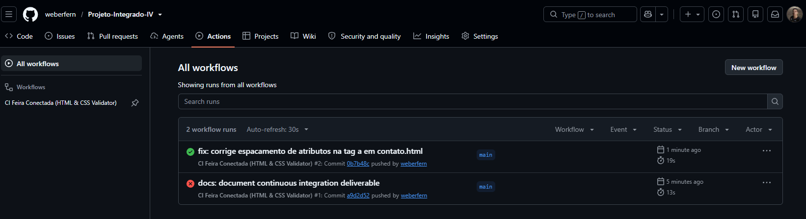

# 🎯 Projeto Integrado IV - Entregável Parcial 1 (EP1): Configuração de um processo de integração contínua utilizando o GitHub Actions

Universidade Federal do Cariri (UFCA)  
Análise e Desenvolvimento de Sistemas (ADS)  
Disciplina: Projeto Integrado IV [ADS0039]  
Disciplina Integrada: Integração de Sistemas  
Professor: Prof. Allysson Allex Araújo

---

## 👥 Equipe

| Nome | Matrícula |
| --- | --- |
| Iago Ronan Almino Oliveira | 2025012453 |
| Jefferson Rodrigues de Oliveira | 2025013432 |
| Lucas Gabriel Correia Gonçalves | 2025013479 |
| Luiz Filipy Soares da Silva | 2025013503 |
| Marcelo dos Santos Alves | 2023010825 |
| Weber Fernandes da Silva | 2025019356 |

---

## 📦 Entregável Parcial 1 (EP1): Integração Contínua com GitHub Actions

Este repositório contém a Landing Page de divulgação da iniciativa **Feira Conectada**. No presente entregável (EP1), o foco é a implementação de um processo automatizado de **Integração Contínua (CI)** utilizando o **GitHub Actions**.

---

## 🌐 Visão Geral do Projeto

A Landing Page da Feira Conectada tem como objetivo divulgar o projeto, centralizar informações para visitantes e atrair novos feirantes para a plataforma. A interface foi desenvolvida com base em padrões modernos da Web (HTML5 semântico, CSS3 responsivo e JavaScript modular). Nesse projeto foi incluído o processo de Integração Contínua (CI) utilizando o GitHub Actions vista na disciplina de Integração de Sistemas [ADS0024].

---

## ⚙️ Processo de Integração Contínua (CI)

### 1. Objetivo do Pipeline
Garantir que todas as alterações enviadas para a branch `main` passem por verificações automatizadas de qualidade antes de serem consideradas estáveis. O pipeline previne que erros de sintaxe no HTML, tags não fechadas ou ausência de arquivos essenciais passem despercebidos durante o trabalho em equipe.

### 2. Gatilhos de Execução
O fluxo de trabalho foi configurado no arquivo `.github/workflows/ci.yml` e é acionado automaticamente em dois cenários:
*   **Push:** Envio direto de commits para a branch `main`.
*   **Pull Request:** Abertura ou atualização de requisições de integração direcionadas à branch `main`.

### 3. Tarefas Automatizadas Implementadas
O job é executado em um ambiente virtual com sistema operacional Ubuntu (`ubuntu-latest`) contendo as seguintes etapas:
*   **Checkout do Código:** Clona os arquivos do repositório no runner do GitHub.
*   **Ambiente de Execução:** Prepara o runtime do Node.js (v20) para execução pontual de utilitários de checagem.
*   **Validação Estática (Linting de HTML):** Utiliza o `htmlhint` para analisar todos os arquivos `.html` do projeto (`index.html` e páginas internas na pasta `paginas/`), identificando inconsistências estruturais e sintáticas.
*   **Teste de Integridade de Arquivos:** Script automatizado em shell para garantir a existência dos arquivos estruturais indispensáveis (`index.html`, `css/style.css` e `js/script.js`).

### GitHub Actions em ação

A execução do workflow de Integração Contínua pode ser acompanhada na aba **Actions** do repositório:



---

## 🎓 Componente Extensionista: O que é Integração Contínua?

### O que é?
A **Integração Contínua** (conhecida pela sigla **CI**, do inglês *Continuous Integration*) é uma prática de engenharia de software em que os membros de uma equipe integram seus códigos com frequência em um repositório compartilhado. A cada integração, testes e análises automatizadas são executados de forma imediata para verificar se as novas alterações introduziram falhas no sistema.

### Por que ela é importante para quem está aprendendo a programar?
Para quem está iniciando na programação, especialmente em cursos como o de ADS na UFCA, é comum trabalhar em projetos colaborativos onde cada integrante desenvolve uma parte isoladamente. Sem a integração contínua, pequenos erros — como uma tag HTML esquecida aberta, um arquivo renomeado de forma incorreta ou um link quebrado — só costumam ser percebidos momentos antes da entrega final, gerando retrabalho e desgaste.

A importância da Integração Contínua para estudantes e para a comunidade reside em três pontos fundamentais:

1. **Segurança no Aprendizado:** Permite que o estudante teste hipóteses e suba seu código sem o receio de "quebrar" o trabalho dos colegas, pois o robô de validação aponta exatamente onde houve o erro.
2. **Feedback Imediato:** Em vez de esperar uma revisão manual, o desenvolvedor sabe em poucos segundos se seu código atende aos padrões de qualidade esperados.
3. **Cultura Profissional:** Prepara o aluno para a realidade do mercado de trabalho, onde a automação e a garantia de qualidade de software são requisitos indispensáveis.

---

## 📁 Estrutura do Repositório

```text
📦 projeto-web-equipe
 ┣ 📂 .github
 ┃ ┗ 📂 workflows
 ┃   ┗ 📜 ci.yml          # Arquivo de configuração da pipeline de CI
 ┣ 📂 css
 ┃ ┗ 📜 style.css        # Folha de estilos da landing page
 ┣ 📂 img                # Imagens e capturas de tela do sistema
 ┣ 📂 js
 ┃ ┗ 📜 script.js        # Scripts de interatividade da página
 ┣ 📂 paginas            # Páginas complementares (contato, integrantes, sobre)
 ┣ 📜 index.html         # Página principal da landing page
 ┗ 📜 README.md          # Documentação do projeto
```
