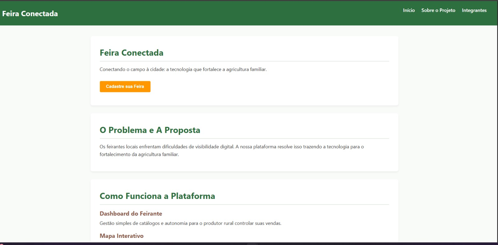
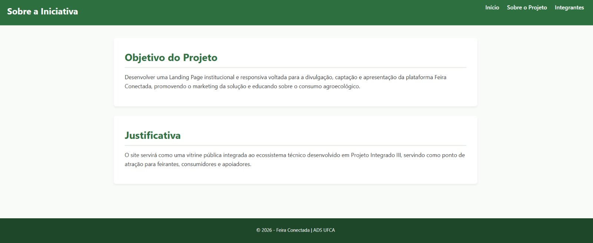
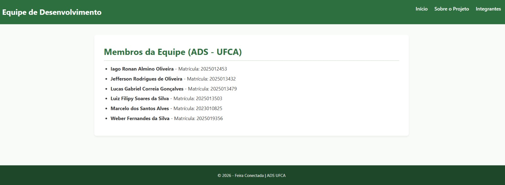

# 🎯 Landing Page do Projeto Feira Conectada

Projeto desenvolvido para a disciplina de Desenvolvimento para Web, do curso de Análise e Desenvolvimento de Sistemas da Universidade Federal do Cariri (UFCA).

## 🧩 Identificação da Atividade

- **Universidade:** Universidade Federal do Cariri (UFCA)
- **Curso:** Análise e Desenvolvimento de Sistemas (ADS)
- **Disciplina:** Desenvolvimento para Web [ADS0015]
- **Professor:** Prof. Jayr Alencar Pereira
- **Projeto:** Feira Conectada

## 🌐 Sobre o Projeto

O Feira Conectada é um projeto voltado para a conexão entre o campo e a cidade, com foco na divulgação e valorização da agricultura familiar por meio da tecnologia.

Este repositório contém a versão web do projeto, com a página principal e páginas complementares de apresentação da proposta e dos integrantes da equipe.

## 🖼️ Preview do Projeto

## 🔗 Repositório de Referência

O projeto está relacionado ao repositório principal:

https://github.com/weberfern/projeto-integrado-iii-mvp

## 👥 Equipe

| Nome | Matrícula |
| --- | --- |
| Iago Ronan Almino Oliveira | 2025012453 |
| Jefferson Rodrigues de Oliveira | 2025013432 |
| Lucas Gabriel Correia Gonçalves | 2025013479 |
| Luiz Filipy Soares da Silva | 2025013503 |
| Marcelo dos Santos Alves | 2023010825 |
| Weber Fernandes da Silva | 2025019356 |

## 🛠️ Estrutura do Projeto

- `index.html` - página inicial
- `css/style.css` - estilos do site
- `js/script.js` - scripts do projeto
- `img/` - imagens e ícones
- `paginas/` - páginas internas do projeto

## 💡 Observação

Este projeto foi desenvolvido como atividade acadêmica da disciplina de Desenvolvimento para Web.
